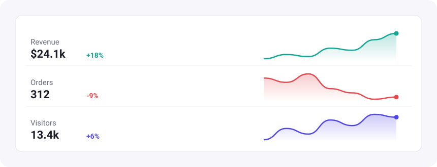

# sparkline_lite

[](https://pub.dev/packages/sparkline_lite)
[](https://github.com/senkop/sparkline_lite/actions/workflows/ci.yml)
[](LICENSE)

A tiny line chart for dashboards, tables and list tiles. No dependencies.

- Smooth curve or straight lines
- Fading area fill under the line
- Dot on the latest value
- Optional lowest/highest value markers
- Any size, including full width
- `sparklinePoints` helper if you want to draw your own



## Install

```bash
flutter pub add sparkline_lite
```

## Usage

```dart
import 'package:sparkline_lite/sparkline_lite.dart';

Sparkline(data: [3, 5, 4, 8, 6, 9])

ListTile(
  title: const Text('Revenue'),
  trailing: Sparkline(
    data: revenue,
    color: Colors.green,
    showMinMax: true,
  ),
)
```

## Example

```bash
cd example
flutter create .
flutter run -d chrome
```

## License

MIT
